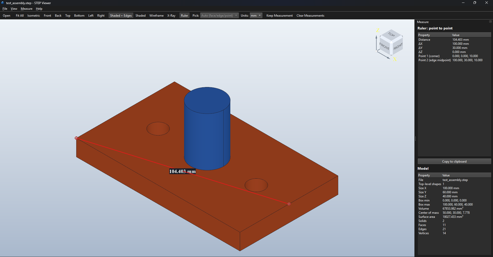
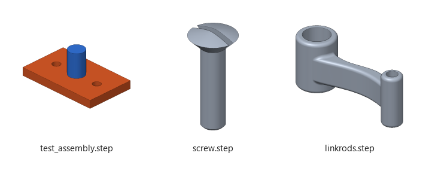
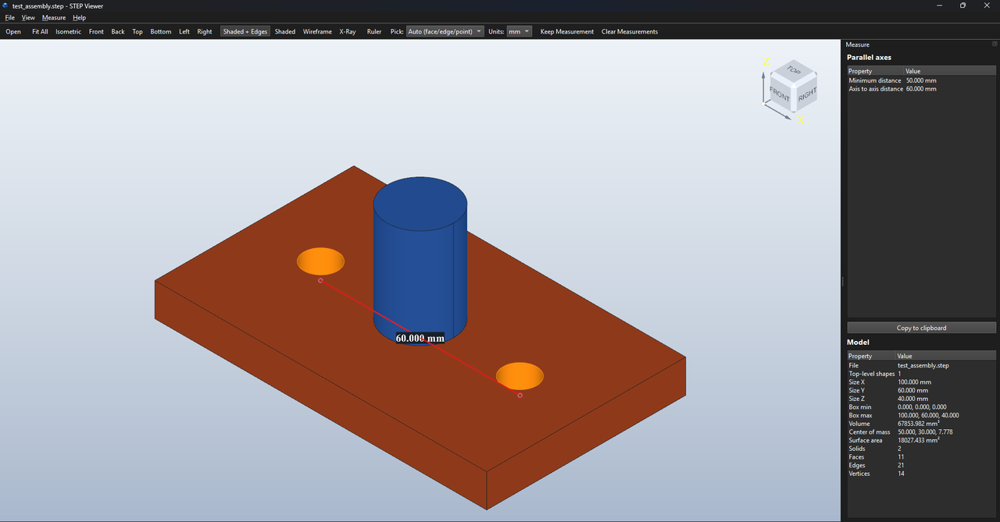

# STEP Viewer for Windows: free STEP / STP file viewer with Explorer thumbnails and measuring

**Open `.step` and `.stp` CAD files on Windows 10 and 11 without installing CAD software.** See 3D previews of your STEP files right in File Explorer, rotate and zoom the model, and measure it: point-to-point distance with a ruler, hole diameters, center-to-center distances, wall thickness, angles, volume and overall size.

Free, open source (MIT), no account, no telemetry and no internet connection needed. The installer is about 25 MB and needs no admin rights.

**[⬇ Download the latest version](https://github.com/kartikddoshi/step-viewer/releases/latest)**: `StepViewer-Setup-x.y.z.exe` (installer) or `StepViewer-x.y.z-portable.zip` (no install)



## Who is this for?

- You received a STEP file from a supplier, customer or 3D-model website and just want to **look at it**.
- You need to **check a dimension** (a hole size, a length or a distance between two points) before you print, machine or order a part.
- You keep a folder full of `.step` files and want to **see what each one is** from its thumbnail instead of its file name.
- You don't have, or don't want to start, SolidWorks, Fusion 360, FreeCAD or another full CAD package just to view a file.

## Features

### Thumbnails in Windows File Explorer
STEP files get a real shaded 3D preview as their icon in File Explorer, in the colors stored in the file. Files that contain only curves (wireframe, sketches) are drawn as lines. Previews are rendered on the CPU, so they also work on machines without a graphics card or over Remote Desktop.



### 3D viewer
- Opens STEP parts and assemblies (AP203, AP214, AP242) with their colors.
- Rotate, pan and zoom, a view cube, standard views (front, top, isometric and others) and fit all.
- Display modes: shaded with edges, shaded, wireframe and X-ray (see-through).
- Opens files by double-click, from **File > Open**, or by dragging them onto the window.

### Measuring tools
All measurements use the exact CAD geometry (the B-rep), not the triangle mesh, so results are exact rather than approximate.

| What you click | What you get |
|---|---|
| **Ruler (R)**: any two points | Straight distance plus ΔX / ΔY / ΔZ. Points snap to corners, edge ends and edge midpoints; anywhere else, the exact point on the edge or face is used |
| A round **edge** or **hole** | Diameter, radius, center and arc angle |
| A straight **edge** | Length and direction |
| A **face** | Area, perimeter, and the diameter of a cylinder, the angle of a cone, the radius of a sphere |
| **Two holes** (Shift+click) | Center-to-center distance and axis-to-axis distance |
| **Two flat faces** | Distance between parallel faces (wall thickness), or the angle between them |
| **Any two items** | Minimum distance and angle between edges, faces and axes |
| Nothing (Model panel) | Overall size (bounding box), volume, surface area, center of mass |

Units are **mm or inch**. **K** keeps a dimension on screen, **Esc** clears, and **Copy to clipboard** copies the results as text.



## Install

1. Download `StepViewer-Setup-x.y.z.exe` from the [Releases page](https://github.com/kartikddoshi/step-viewer/releases/latest).
2. Run it. By default it installs for your user account only, so no administrator rights are needed.
3. Windows may show **"Windows protected your PC"**, because the installer is not code-signed (signing certificates cost money). Click **More info**, then **Run anyway**.
4. Open a folder of STEP files and press **F5**. Thumbnails appear in Medium icons view or larger.

To uninstall, go to **Settings > Apps** and choose **STEP Viewer > Uninstall**. This also removes the thumbnails and the file association.

**Portable version:** unzip `StepViewer-x.y.z-portable.zip` anywhere and run `StepViewer.exe`. To get Explorer thumbnails without installing, run `regsvr32 StepThumb.dll` in that folder. `regsvr32 /u StepThumb.dll` turns them off again.

If double-clicking a `.step` file still opens another program, right-click the file, choose **Open with > Choose another app**, pick **STEP Viewer** and tick **Always**.

## Mouse and keyboard

| Action | Input |
|---|---|
| Rotate | Left drag (rotates around the point under the cursor) |
| Pan | Middle drag, right drag, or Ctrl + left drag |
| Zoom | Mouse wheel (zooms toward the cursor) |
| Select / measure | Click a face, edge or corner. The **Pick** box limits clicks to faces, edges, corners or solids |
| Measure between two items | Shift + click the second item |
| Ruler (point to point) | `R`, then click two points |
| Keep dimension / clear | `K` / `Esc` |
| Fit / isometric / standard views | `F` / `0` / `1`–`6` |
| X-ray | `X` |
| Open | `Ctrl+O` |

## FAQ

**How do I open a STEP file without CAD software?**
Install STEP Viewer and double-click the `.step` or `.stp` file, or drag it onto the STEP Viewer window.

**How do I see thumbnails of STEP files in File Explorer?**
Installing STEP Viewer adds an Explorer thumbnail handler for `.step` and `.stp` files. Switch the folder to Medium, Large or Extra large icons and press F5.

**How do I measure the distance between two points in a STEP file?**
Press **R** (Ruler), click the first point and then the second. The distance appears on the model and in the Measure panel, with its X, Y and Z components.

**How do I find the diameter of a hole?**
Click the inside face of the hole or its round edge. The Measure panel shows the diameter, radius and center.

**Can it edit or convert files?**
No. It is a viewer and measuring tool only, and it never modifies your files.

**Which other formats does it open?**
Only STEP (`.step`, `.stp`, `.p21`).

**Is my data uploaded anywhere?**
No. Everything runs locally and the app makes no network connections.

## Known limitations

- Windows 10 / 11, 64-bit only.
- PMI and GD&T annotations stored in AP242 files are not shown, only the geometry.
- Very large assemblies (hundreds of MB) load slowly, and their Explorer thumbnails can take a while to appear. Files over 512 MB get no thumbnail.

## Build from source

You need:
- Windows 10 or 11, 64-bit.
- [Visual Studio 2022 or 2026 Build Tools](https://visualstudio.microsoft.com/downloads/) with the **Desktop development with C++** workload.
- [Python 3](https://www.python.org/downloads/) on PATH.

```powershell
git clone https://github.com/kartikddoshi/step-viewer.git
cd step-viewer
powershell -ExecutionPolicy Bypass -File scripts\setup-deps.ps1     # OpenCASCADE, Qt, CMake/Ninja, Inno Setup -> deps\
powershell -ExecutionPolicy Bypass -File scripts\build.ps1          # -> build\out\StepViewer.exe
powershell -ExecutionPolicy Bypass -File scripts\make-installer.ps1 # -> dist\StepViewer-Setup-1.0.0.exe
```

`setup-deps.ps1` downloads about 1.5 GB and installs these into `deps\`:
- OpenCASCADE 8.0.1, prebuilt for MSVC x64.
- Qt 6.8.3 (msvc2022_64), through aqtinstall.
- Inno Setup 6.7.4, which is only needed for the installer. Skip it with `-NoInstaller`.

Testing:

```powershell
# exact-geometry self-test: builds a part with known dimensions, writes and re-reads it as STEP, checks every measurement
$env:PATH = "$PWD\build\out;$env:PATH"; .\build\test\selftest.exe $env:TEMP\selftest.step

# thumbnail handler without installing (current user only)
regsvr32 build\out\StepThumb.dll         # register
regsvr32 /u build\out\StepThumb.dll      # unregister
python scripts\test_thumb.py build\out $env:TEMP\thumbs 256 samples\screw.step   # render previews to PNG
```

### Code layout

```
src/core     StepModel (STEP -> XCAF document), ThumbRenderer (CPU rasterizer used for Explorer thumbnails)
src/app      Qt GUI: OcctWidget (OpenGL viewport), MainWindow (UI, ruler), Measure (exact B-rep measurements)
src/thumb    Explorer IThumbnailProvider COM server (StepThumb.dll)
tools        selftest.cpp: headless measurement and thumbnail test
installer    Inno Setup script: file association + thumbnail handler registration
scripts      setup-deps, build, make-installer, test helpers
samples      Example STEP files
```

## Contributing

Bug reports and pull requests are welcome. If a STEP file doesn't open, renders wrong or measures wrong, please [open an issue](https://github.com/kartikddoshi/step-viewer/issues). Attach the file if you can share it, or describe where it came from (which CAD program exported it).

## License

- **STEP Viewer** source code: [MIT](LICENSE).
- **Open CASCADE Technology**: LGPL 2.1 with the OCCT exception.
- **Qt 6**: LGPL 3.
- Both libraries are linked dynamically, and their license texts ship in the `licenses` folder of every download.
- The prebuilt OpenCASCADE binaries also bring FreeType, FreeImage, oneTBB, jemalloc, FFmpeg and OpenVR DLLs. FFmpeg and OpenVR are never used by this app. Rebuilding OpenCASCADE with `USE_FFMPEG=OFF USE_OPENVR=OFF` would drop about 20 MB.
- `samples/screw.step` and `samples/linkrods.step` come from the Open CASCADE sample data.

---

*Keywords: STEP viewer, STP viewer, free STEP file viewer for Windows 11 / Windows 10, open .step file, open .stp file, ISO 10303, AP203, AP214, AP242, STEP thumbnail provider for File Explorer, STEP file preview, measure STEP file, CAD viewer, 3D model viewer, OpenCASCADE, OCCT, Qt.*
